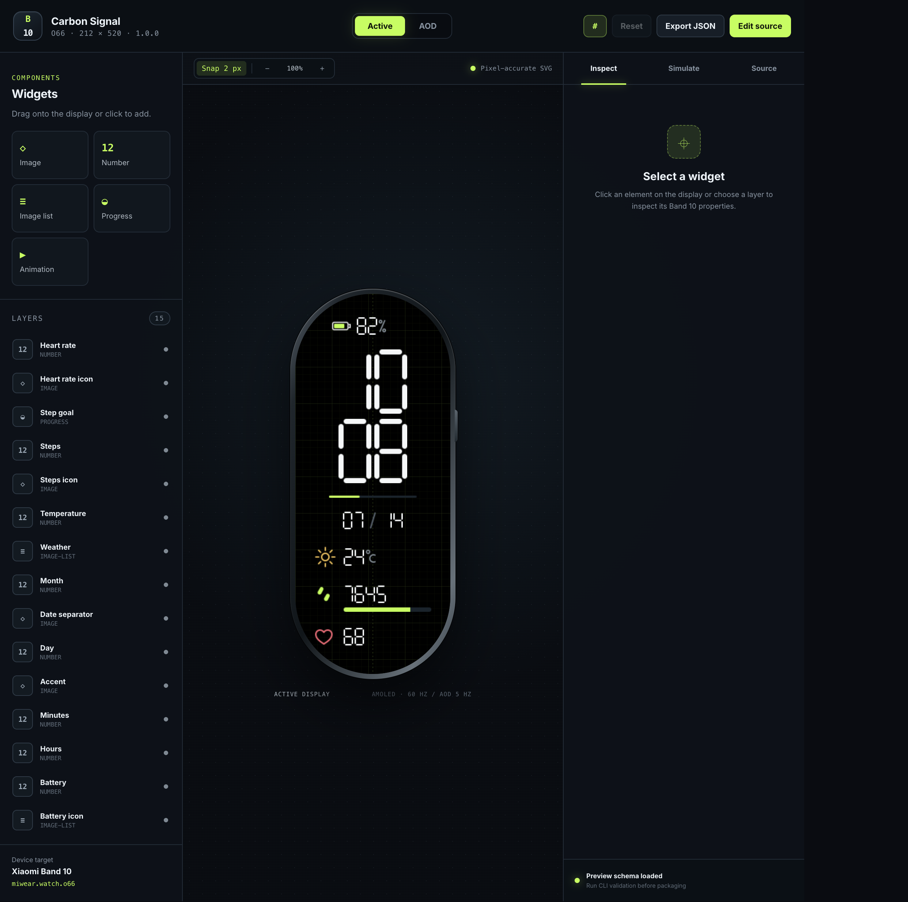
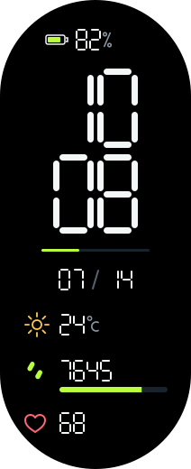
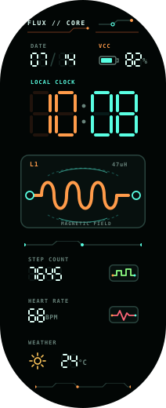
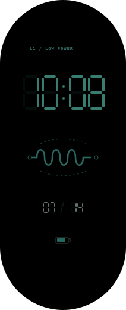
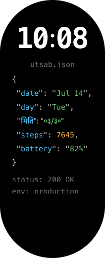
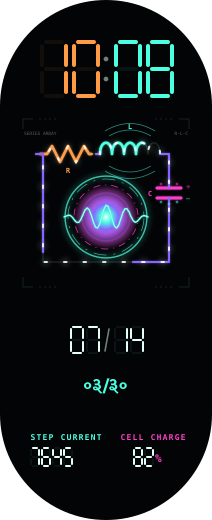
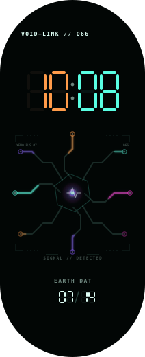

# Band 10 Toolkit

[](https://github.com/utsabfdahal/band10-toolkit/actions/workflows/ci.yml)
[](LICENSE)
[](https://nodejs.org)
[](tsconfig.json)

An open, source-first development workflow for custom **Xiaomi Smart Band 10** (`o66`) watch faces.

Design assets, describe widgets in JSON, validate, live-preview in React/SVG, generate editable FPRJ/GMF projects, package a reverse-engineered `.face`/`.bin`, inspect it, and install it on a real device.

> **Hardware status:** faces generated with this toolkit have been **successfully installed and displayed on a physical Xiaomi Smart Band 10**, transferred to the watch through the **Notify (Notify for Mi Band)** Android app. The packages render correctly on-device, including the active and always-on displays. Behaviour can still vary across firmware and regions, so verify your own build on your own band before relying on it.



| Active face | Always-on display |
|---|---|
|  |  |

## Getting started (build & open the simulator)

Everything runs locally. You only need **Node.js 22+** and **git**.

**1. Clone the repo and install dependencies**

```sh
git clone https://github.com/utsabfdahal/band10-toolkit.git
cd band10-toolkit
npm install
```

**2. Generate the source artwork for the example face**

```sh
npm run generate:assets
```

**3. Open the live simulator (the React/SVG watch studio)**

```sh
npm run preview
```

This starts the studio's dev server. Open the URL it prints — by default
**http://localhost:5173** — in your browser to see the watch face rendered at
the real 212×520 Band 10 resolution, with drag/drop, a layer inspector, live
JSON editing, and a data simulator. Press `Ctrl+C` in the terminal to stop it.

**4. Build, validate, and package a `.face` (optional)**

```sh
npm run validate        # schema, coordinates, storage, capability checks
npm run build:example   # render preview + FPRJ/GMF intermediates
npm run package         # write the .face / .bin package
npm run inspect         # print headers, resources, and bindings
```

The packaged files land in `examples/minimal-amoled/dist/`.

**5. Install it on a real Band 10**

The generated `.face` package can be pushed to a physical watch with the
**Notify (Notify for Mi Band)** Android app: open Notify → *Watchface* →
import the `.face` file → sync to the band. This is how the faces in this repo
were verified on-device, including their always-on displays.

### Preview any of the other faces

Each design has its own `preview` script that generates its assets and opens
the same simulator:

```sh
npm run preview:flux       # Flux Core electronics face
npm run preview:backend    # utsab.json developer face
npm run preview:rlc        # RLC Singularity animated circuit
npm run preview:circuit    # Circuit Link reactor
npm run preview:odyssey    # Odyssey landscape video loop
```

## Flux Core electronics design

The [`examples/flux-core`](examples/flux-core) face is a clean electronics-themed design with copper/cyan PCB digits, an `L1 / 47uH` inductor module, magnetic-field traces, oscilloscope telemetry, and a restrained AOD. Collision-aware validation reports no clipping or overlaps, and the layout uses no `allowOverlap` exceptions.

| Active display | Always-on display |
|---|---|
|  |  |

```sh
npm run generate:flux
npm run validate:flux
npm run build:flux
npm run package:flux
npm run inspect:flux
npm run preview:flux
```

## Featured designs

A gallery of source-first faces built with this toolkit. Every pixel is
generated deterministically from a script + `layout.json` — no binary editors.

### `utsab.json` — developer / JSON debugger

A syntax-highlighted, pretty-printed JSON view of today's status on true-black
AMOLED: a bold monospace clock, an English date, a **Nepali (Bikram Sambat)
date** line with a Devanagari key, steps, battery, and decorative
`status: 200 OK` / `env: production` metadata. Keys are cyan, strings green,
numbers orange, punctuation gray — exactly like a live API response on the wrist.

| Active display | Always-on display |
|---|---|
|  |  |

```sh
npm run generate:backend
npm run validate:backend
npm run package:backend
npm run preview:backend
```

### RLC Singularity — animated resonant circuit

A series **R–L–C** circuit that synthesizes itself: the resistor forms, the
inductor grows a magnetic field, the capacitor locks its charge, and the loop
ignites into a rotating resonance core. 48 indexed-colour frames at 60 ms,
month/day English + Nepali dates, steps, and battery, with a calm static AOD.

| Active display | Always-on display |
|---|---|
|  |  |

```sh
npm run generate:rlc
npm run validate:rlc
npm run package:rlc
npm run preview:rlc
```

### Circuit Link (VOID-LINK) — self-assembling reactor

An "otherworldly" ignition sequence: eight circuit traces zip inward, particles
converge, dual glyph rings counter-rotate, the core detonates two shockwaves,
then the link collapses back to a dormant seed. 48 opaque indexed frames at
60 ms, looping seamlessly.

| Active display | Always-on display |
|---|---|
|  |  |

```sh
npm run generate:circuit
npm run validate:circuit
npm run package:circuit
npm run preview:circuit
```

> Animated faces are frame flipbooks (the firmware has no vector tween engine).
> Video-backed faces (a background-removed portrait, and a landscape trailer
> loop) are also supported via an `ffmpeg` → indexed-PNG pipeline, but their
> generated frames are intentionally **not** committed here (large, and derived
> from personal or third-party copyrighted video).

## What is included

- bounds-safe parser for the `5A A5 34 12` modern Xiaomi binary;
- native palette/BGRA image blocks and RLE v1/v2 codecs;
- semantic asset/coordinate/storage validator with error codes;
- canonical `manifest.json` + `layout.json` schemas;
- FPRJ XML and GMF `wfDef.json` exporters;
- experimental open `o66` binary packer with active + AOD support;
- closed-compiler and community-Java adapters (binaries are not redistributed);
- React 19 + SVG desktop preview studio;
- direct drag/drop, layer inspector, live JSON, and data simulation;
- deterministic source-asset generation and 212×520 preview rendering;
- complete minimal AMOLED example with time, date, battery, steps, heart rate, weather, progress, and AOD;
- clean Flux Core electronics/inductor face with collision-tested active and AOD layouts;
- safe ADB staging and optional Gadgetbridge confirmation-UI launch;
- research report, format notes, project catalog, architecture diagrams, and install/publish guidance;
- 30 automated unit/integration tests.

## Quick start

Requirements: Node.js 22+ and npm.

```sh
npm install
npm run generate:assets
npm run validate
npm run build:example
npm run package
npm run inspect
npm run preview
```

The example package appears at:

```text
examples/minimal-amoled/dist/carbon-signal.face
examples/minimal-amoled/dist/carbon-signal.bin
```

Those two files are byte-identical extension aliases.

## Project format

```text
my-face/
├── manifest.json
├── layout.json
└── assets/
    ├── digits/
    ├── icons/
    └── weather/
```

Start from [`templates/basic`](templates/basic), [`examples/minimal-amoled`](examples/minimal-amoled), or the clean electronics-themed [`examples/flux-core`](examples/flux-core).

The schema uses meaningful source names such as `battery`, `steps`, and `heartRate`; exporters map them to recovered Band 10 IDs (`0841`, `0821`, `0822`, etc.).

## Commands

| Command | Purpose |
|---|---|
| `band10 validate <project>` | schema, assets, coordinates, dimensions, storage, capability warnings |
| `band10 assets <project>` | normalize source artwork to deterministic PNGs |
| `band10 build <project>` | render preview and write FPRJ + GMF intermediates |
| `band10 package <project>` | package `.face` + `.bin` with selected backend |
| `band10 inspect <file>` | print headers, sections, resources, coordinates, and bindings |
| `band10 preview <project>` | synchronize project and run React studio |
| `band10 clean <project>` | remove `build/` and `dist/` |
| `band10 install <file>` | ADB-stage to Android; optional Gadgetbridge confirmation launch |

Use through npm:

```sh
npm run band10 -- validate path/to/project
```

Machine-readable output is available from `validate --json` and `inspect --json`.

## Package backends

| Target | Openness | Current confidence |
|---|---|---|
| `native` | MIT code in this repository | Structure/resources round-trip; **installed and rendering on a physical Band 10 via the Notify app** |
| `mi-create` | Adapter open; compiler closed/user-supplied | Community production path; requires Windows/Wine |
| `mi8-tool` | Adapter open; external Java source has no license | Experimental; known parser failures on valid samples |

Nothing proprietary is downloaded or executed implicitly.

## Verified local results

On this macOS development session:

- strict TypeScript: passed for CLI/core and React;
- ESLint: passed;
- tests: **30/30 passed**;
- production preview: 224.63 kB JS (69.06 kB gzip), 15.09 kB CSS (4.15 kB gzip);
- example: 41 source assets, 21 widgets, active + AOD;
- package: 53,056 bytes (~51.8 KiB);
- decoded package: 212×520 preview, 8 singles, 7 image lists, 216,648 pixels;
- parser warnings: zero;
- 16 dynamic widget bindings decoded correctly across both faces.
- Flux Core: 76 assets, 33 widgets, zero validation issues, 24 active + 9 AOD elements, 100.9 KiB package.

These are build/test metrics, not Band battery/runtime performance claims.

## Research conclusions

- `.face` and `.bin` commonly contain the same raw binary, not ZIP archives.
- runtime magic is `5A A5 34 12` for inspected Band 10 faces;
- the runtime binary is not whole-file encrypted; images may be palette/RLE compressed;
- authoring commonly uses `.fprj` XML or `wfDef.json`;
- AOD is separate face content/resources;
- normal typography is raster glyph sprites, not an embedded authoring font;
- Xiaomi officially documents 212×520, AOD, roughly 20 MB face storage, and up to nine downloaded faces;
- Xiaomi does not publish the low-level Band 10 runtime format or an open global full-face submission path.

Read [the complete research report](docs/research.md) before relying on format details.

## Documentation

- [Research: all twelve questions and primary sources](docs/research.md)
- [Binary format](docs/format.md)
- [Open-source project landscape](docs/open-source.md)
- [End-to-end workflow](docs/workflow.md)
- [Architecture and diagrams](docs/architecture.md)
- [Authoring, widgets, fonts, weather, progress, animation, AOD](docs/authoring.md)
- [Build, installation, safety, publishing](docs/installation.md)
- [Known limitations](docs/limitations.md)

## Installation warning

Opening a package in Gadgetbridge/Notify still crosses a hardware-risk boundary. Confirm model/resolution and keep the manual install confirmation. A malformed package can crash the face subsystem and potentially require reset/recovery. This project is not affiliated with Xiaomi.

## Contributing

Useful contributions include:

- anonymized/self-authored Band 10 test vectors with hashes and provenance;
- physical-device results including firmware/region/backend;
- raw-byte fixtures for pointers, jumps, editable groups, named styles, and scripts;
- codec tests before encoder changes;
- improvements that preserve unknown bytes rather than guessing.

Do not contribute Xiaomi proprietary compiler binaries, paid faces, credentials/AuthKeys, or copyrighted artwork without permission.

## License

Toolkit source is MIT. Third-party projects, compilers, samples, and artwork retain their own licenses. Absence of a license means no reuse permission—not “free to copy.”
