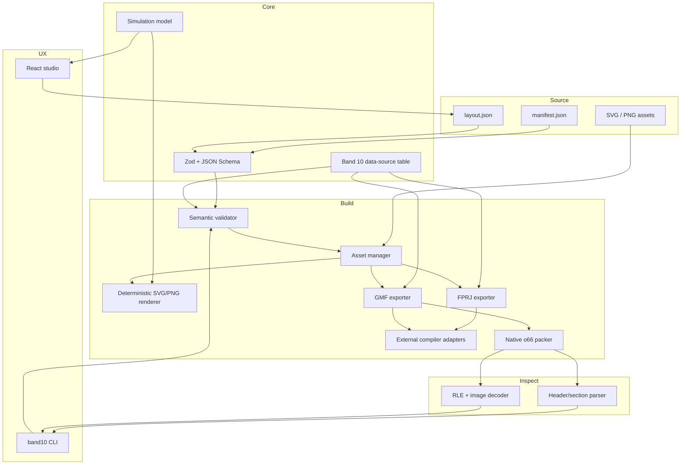
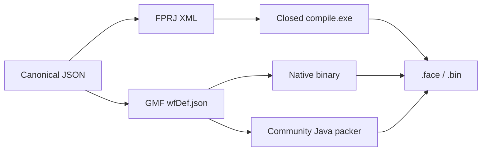

# Toolkit architecture

## Repository map

```text
band10-toolkit/
├── assets/             # shared asset-pipeline documentation
├── builder/            # loader, validator, renderer, FPRJ/GMF/native builders
├── cli/                # automation entry point
├── core/               # canonical types, schemas, bindings, simulator
├── docs/               # research, format, workflow, authoring, install
├── examples/           # complete source faces
├── parser/             # bounds-safe binary/RLE/image parser
├── preview/            # React + SVG browser studio
├── schemas/            # editor-facing JSON Schema files
├── scripts/            # deterministic generation/synchronization
├── templates/          # minimal buildable project
└── tests/              # unit and end-to-end package tests
```

## Component graph



## Canonical model versus compiler formats

The canonical JSON intentionally does not expose raw binary indices/offsets. It uses semantic types (`number`, `image-list`, `progress`) and names (`battery`, `steps`, `heartRate`). Exporters translate that model into numeric community schemas.



This split provides:

- readable source control diffs;
- browser tooling independent of proprietary compilers;
- multiple package backends from one source;
- a place to preserve unknown/raw format data in future parser revisions;
- honest capability gates when a backend cannot represent a source feature.

## Native package algorithm

1. Parse strict GMF intermediate.
2. Collect single-image and image-list resources per face.
3. Normalize images to RGBA.
4. If ≤256 colors, emit BGRA palette + indices + RLE v2; otherwise BGRA32 + RLE v1.
5. Calculate all headers, definition starts, property starts, preview, and resource offsets before writing.
6. Emit active face, preview/resources, then AOD face/resources in the observed legacy-AOD order.
7. Parse the resulting bytes again and reject structural out-of-bounds warnings.
8. Write atomically, then mirror `.face` to `.bin`.

## Error model

Validation issues have severity, stable code, human message, JSON path, and optional repair hint. Build/package errors fail non-zero. The CLI has a `--json` validation/inspection mode for CI.

No operation silently downloads or executes a proprietary compiler. External backends require an explicit path/environment variable.

## Extension points

- New data source: add it in `core/dataSources.ts`, `core/types.ts`, and both schemas.
- New widget: add canonical type/schema, preview renderer, FPRJ/GMF translation, validator rules, then native property encoding.
- New device: do not overload Band 10 assumptions; create a separate device profile and codec capability matrix.
- Unknown binary block: preserve raw bytes and add corpus fixtures before writing an encoder.
- Installer: add a companion adapter only when its public intent/protocol contract is verified.
