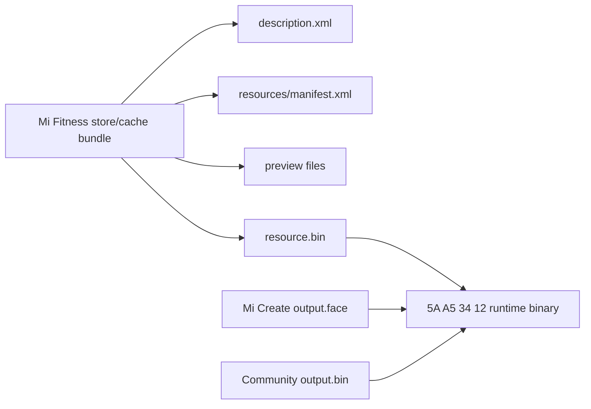

# Band 10 binary format notes

This is a reverse-engineered working document, not a Xiaomi specification. All integers below are little-endian unless stated otherwise.

## Physical layout

Exact offsets after the headers are stored in the headers/definitions; sections need not be inferred from physical adjacency.

## Main header (`0xA8` bytes)

| Offset | Size | Field | Observed Band 10 value/meaning |
|---:|---:|---|---|
| `0x00` | 4 | magic | `5A A5 34 12` |
| `0x10` | 4 | device flags | commonly `0x00000800` |
| `0x1C` | 2 | face count | active/AOD or multi-style record count |
| `0x1E` | 2 | style count | semantics partly unresolved |
| `0x20` | 4 | preview offset | absolute image-block offset |
| `0x28` | 9 | ID | ASCII digits, commonly exactly nine |
| `0x68` | 60 | name | null-padded UTF-8/ASCII |

## Face header (`0x58` bytes)

Each section pair is `(count: u32, absoluteOffset: u32)`.

| Pair offset | Definition type | Content |
|---:|---:|---|
| `0x08` | 0 | base elements |
| `0x18` | 2 | single-image resources |
| `0x20` | 3 | image-list resources |
| `0x28` | 4 | animations |
| `0x30` | 5 | JS/Lua/script resources |
| `0x40` | 7 | widget properties |
| `0x48` | 8 | editable/customizable properties |
| `0x50` | 9 | jump/tap properties |

`+0x04` is a face-specific preview offset. Some multi-style faces place a `0x48` name/style block after each face header; support remains experimental.

## Definition entry (`16` bytes)

| Offset | Size | Field |
|---:|---:|---|
| `+0x00` | 2 | index |
| `+0x03` | 1 | type |
| `+0x08` | 4 | absolute data/resource offset |
| `+0x0C` | 4 | data/resource length |

Definitions are indirection records. A base element refers to a definition by `(type, index)`; this is why array position alone is insufficient.

## Base element property (`16` bytes)

| Offset | Size | Field |
|---:|---:|---|
| `+0x00` | 3 | referenced definition index |
| `+0x03` | 1 | referenced definition type |
| `+0x04` | 2 | x coordinate |
| `+0x06` | 2 | y coordinate |
| `+0x08` | 8 | unresolved/reserved in basic elements |

## Widget property (type 7)

The first three bytes encode a data source. Most Band 10 sources are two bytes (`08 41` for battery `0841`); some source families use a third byte. `+0x03` has a high-nibble widget class and low-bit flags.

| High nibble | Widget | Common length |
|---:|---|---:|
| `0x10` | digital number | 20 bytes |
| `0x20` | image list | `16 + 4 × mapping count` |
| `0x30` | pointer | 32 bytes |
| `0x40` | progress | 40 bytes |

For digital numbers, byte `+2` is also observed as display count in two-byte-source records; parsers must prefer a known two-byte source before treating it as a third source byte.

## Animation property (type 4, observed 12 bytes)

| Offset | Size | Field |
|---:|---:|---|
| `+0x00` | 3 | image-list definition index |
| `+0x03` | 1 | reference type (`3`) |
| `+0x06` | 2 | interval |
| `+0x08` | 2 | repeat count |

## Image block

| Offset | Size | Field |
|---:|---:|---|
| `+0x00` | 1 | sign/encoding |
| `+0x01` | 1 | flags or image-list count |
| `+0x02` | 1 | list compression flag |
| `+0x04` | 2 | width |
| `+0x06` | 2 | height |
| `+0x08` | 4 | payload length |
| `+0x0C` | variable | payload |

Observed/implemented encodings:

- sign `0x10`: 1,024-byte BGRA palette + one-byte indices; often RLE v2 compressed;
- sign `0`: BGRA32 in modern-family community tools;
- sign `3`: RGB565 without alpha in older variants;
- sign `6`: RGB565 plus alpha byte in an `n66` variant;
- signs 9/10/14 occur in script-image variants and are not emitted by this toolkit.

Compressed payloads begin `E0 21 A5 5A`; the next `u32` is `(rawLength << 4) | bytesPerPixel`.

## Store delivery bundle versus runtime binary

The following must remain separate:

The public evidence does not establish one universal delivery-envelope schema across regions/app versions. The runtime binary is the stable target for this toolkit.

## Parser behavior

`band10 inspect <file>`:

- rejects a non-Band-10-family magic;
- bounds-checks every table/property read;
- reports section/type inconsistencies and out-of-file pointers;
- names known data sources;
- intentionally preserves unknown bytes rather than guessing their meaning.

The native packer supports the verified/basic subset. It does not yet emit editable groups, jump actions, pointers, scripts, named multi-style faces, or source IDs longer than three bytes.
