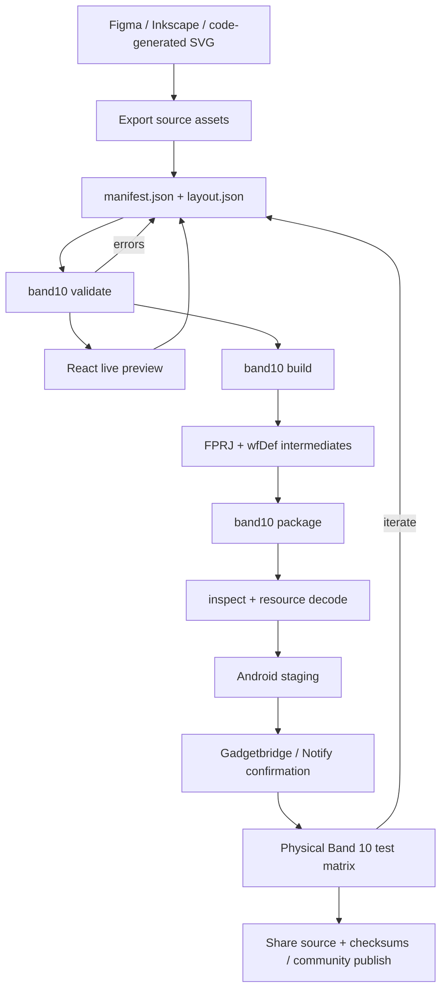

# Recommended development workflow



## 1. Design at the device's real pixel size

Create a 212×520 frame in Figma, Inkscape, Affinity, or another design tool. Keep the true Band 10 pill mask visible and use integer coordinates.

- Export bitmap artwork at 1×; do not “retina” double it.
- Prefer SVG source for icons and generated seven-segment/bitmap typography.
- Merge static decoration into fewer layers where practical.
- Keep AOD mostly black with a small lit area.
- Do not rely on CSS/vector fonts at runtime; export every required glyph.

The toolkit rasterizes SVG at its declared pixel dimensions. A `45×88` SVG becomes a `45×88` PNG.

## 2. Create the source project

Start from `templates/basic/` or copy `examples/minimal-amoled/`.

```text
my-face/
├── manifest.json       # identity, target, output/backend
├── layout.json         # open canonical layout
└── assets/             # source artwork; nested folders are fine
```

Give the face a unique nine-digit ID. Reusing an ID can cause the device/installer to treat a new build as an already-installed face; remove the old face before retesting.

## 3. Validate early

Run the validator whenever assets or layout change. It checks:

- strict JSON schema;
- Band 10 device/resolution and nine-digit ID;
- missing/unreadable/path-escaping assets;
- duplicate widget IDs;
- mismatched digit/frame dimensions;
- aligned-widget clipping;
- AOD animation risk;
- raw asset-size estimate against Xiaomi's roughly 20 MB face storage;
- experimental widget/backend features.

Warnings are not hidden. A project can package with warnings, but the warning becomes part of the test plan.

## 4. Preview without installing

The React studio provides:

- 212×520 SVG rendering inside a Band 10 hardware frame;
- active/AOD switch;
- direct widget dragging with 2px snapping;
- palette-to-canvas drag/drop;
- layer list, X/Y/z/opacity inspector, duplicate/delete;
- clock, battery, steps, heart-rate, stress, weather, temperature, Bluetooth, and sleep simulation;
- canonical JSON editing/export.

The browser preview intentionally emulates data/layout behavior; it does not emulate firmware timing, RAM limits, AOD burn-in shifting, touch routing, or exact image decoder bugs.

Screenshot: [`docs/screenshots/studio.png`](screenshots/studio.png).

## 5. Build editable intermediates

`band10 build` always emits:

```text
build/
├── preview.png
├── build-report.json
├── assets-normal/
├── assets-aod/
├── fprj/
│   ├── <output>.fprj
│   ├── images/
│   └── AOD/
│       ├── AOD.fprj
│       └── images/
└── gmf/
    ├── wfDef.json
    ├── images/
    └── images_aod/
```

These artifacts make the build inspectable and let you compare the open/native pipeline against Mi Create/EasyFace.

## 6. Package with an explicit backend

Backends:

| Backend | Requirement | Use |
|---|---|---|
| `native` | Node only | Open implementation; verified by structural/resource round trip; hardware acceptance not yet verified |
| `mi-create` | User-supplied `compile.exe`; Windows or Wine | Community production comparison; compiler is closed and not redistributed |
| `mi8-tool` | User-supplied `.java`/`.jar` | Experimental public-source comparison; tool has no license and failed some valid samples |

The result is written as both `<output>.face` and `<output>.bin`; the bytes are identical.

## 7. Inspect every package

Before any device transfer:

- confirm magic `5aa53412`;
- confirm ID/name and expected active/AOD face count;
- review definitions and each data-source binding;
- reject any out-of-file offsets or resource decode errors;
- archive the SHA-256 and build report.

The included example currently packages to about 52 KiB and round-trips all embedded resources in automated tests. This does not equal physical-device validation.

## 8. Install with a human confirmation boundary

The install command stages the binary into Android `Download/`. With `--launch-gadgetbridge`, it opens Gadgetbridge's exported `FileInstallerActivity` using `application/octet-stream`; **you still review and tap Install manually**.

Never automate an unattended firmware/watch-face flash. A malformed face can crash or, on devices with weak recovery, brick the wearable.

## 9. Test on hardware systematically

Record:

- Band model/region (`o66` vs NFC variant);
- firmware version;
- Android model/version;
- companion and version;
- build backend/hash;
- install success/time;
- active/AOD visuals;
- 12/24-hour behavior;
- DD/MM and MM/DD requirements;
- battery boundaries 0/1/19/20/49/50/79/80/99/100;
- weather gaps (0, 1, 7, 14, 18, 53, 99, 301);
- negative temperatures;
- zero/maximum steps and heart-rate unavailable state;
- AOD wake/sleep transitions and power behavior.

Do not publish the native backend's output as “Band 10 verified” until an actual device accepts and exercises it.

## 10. Share responsibly

Publish source, license, preview, runtime binary, SHA-256, device/firmware test matrix, and build command. Separate your own assets from copyrighted ports. See [installation and publishing](installation.md).
